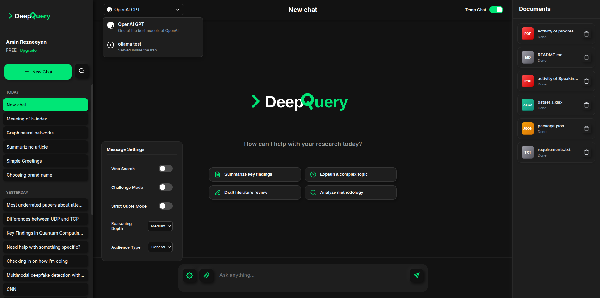
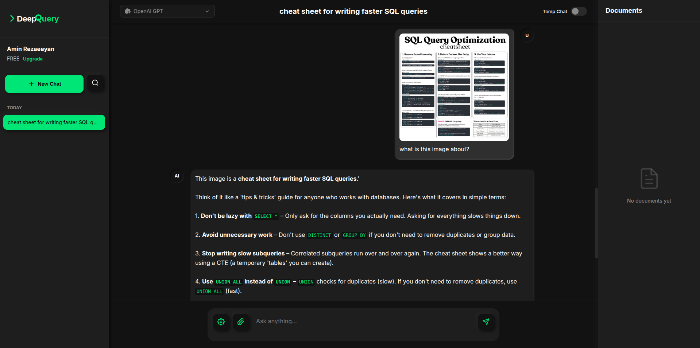
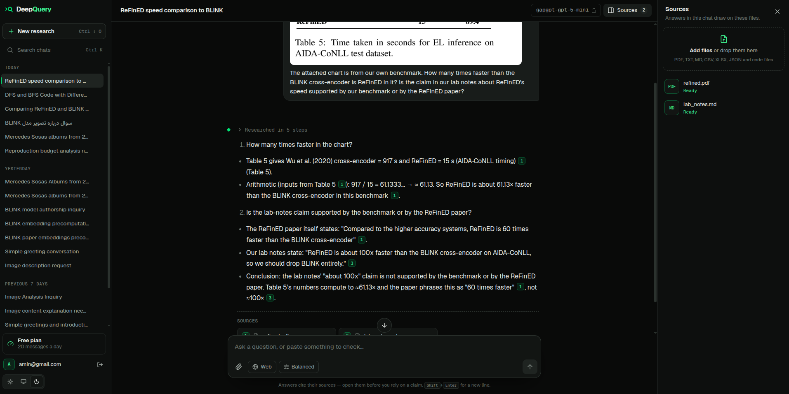
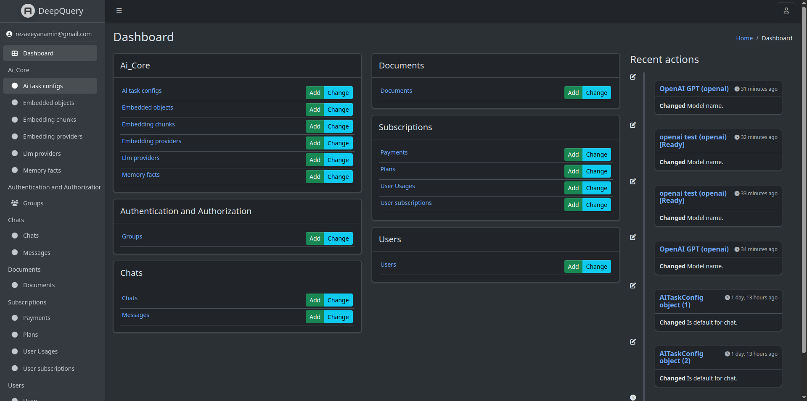

<div align="center">
  

  <h1>DeepQuery</h1>
  <p><strong>An Advanced AI Research Assistant Agent</strong></p>

  [](https://www.djangoproject.com/)
  [](https://www.postgresql.org/)
  [](https://docs.celeryq.dev/)
  [](#license)
</div>

## 📖 Overview

**DeepQuery** is an AI research assistant. You ask a question; a research agent works it out in steps, searching and reading the documents you upload, the web and Wikipedia with its tools, and answers with a citation for each claim, down to the page. It uses Retrieval-Augmented Generation (RAG) over PostgreSQL + pgvector and streams answers, and the steps that led to them, from the LLM provider you configure.

It's also a portfolio project, so the README describes what works today, not what's planned.

## ✨ Key Features

### 🧠 Research & RAG
*   **Research agent:** A plain-Python loop with native tool calling (no agent framework): each turn the model either answers or calls a tool, reads the result and continues, up to a step limit. The steps show live in the chat and stay with the answer. Tools: `search_documents`, `read_document` (an exact page or sheet), `find_text` (exact words on every page, like Ctrl-F), `web_search`, `fetch_page` (with search inside the page), `wikipedia` (sections, tables and past revisions) and `run_python`. Before an answer that used tools is shown, the agent critiques its draft: it lists the question's parts, pairs each claim with the source sentence that states it (dropping the rest), re-checks numbers and code, and can call more tools; then it writes the final answer from that critique (`AGENT_REVIEW`, two extra model turns). For reasoning models such as gpt-5-mini, `AGENT_REASONING_EFFORT=high` makes the agent's turns think harder (slower and costlier; the judge and other calls are unaffected). Providers without tool calling answer in a single retrieval pass instead.
*   **Code Execution:** `run_python` runs model-written Python (pandas, numpy and openpyxl available) on read-only copies of the chat's files, for arithmetic, table statistics and working out what a script prints. Each run gets a 20 s time limit, 1 GB of memory and no network. With [bubblewrap](https://github.com/containers/bubblewrap) installed (`sudo apt install bubblewrap`) it runs in its own namespace and sees only the Python install and its working directory. Without it, it falls back to a plain subprocess with the same limits, which can still read files the server user can read, so install bubblewrap (or run the server in a container) anywhere users aren't trusted. `CODE_SANDBOX=off` removes the tool.
*   **Document Q&A:** Upload PDF, TXT, Markdown, CSV, XLSX, JSON and code files to a chat. They're split into passages per page or sheet and embedded. The agent searches them by meaning (pgvector) and by keyword (BM25), merging the two rankings, so exact names, numbers and terms are found too.
*   **Web Search:** When enabled, the agent can search the web (`ddgs`, no API key; DuckDuckGo first, then Yahoo), read pages and look things up on Wikipedia. Only public addresses are fetched.
*   **Citations:** Every source a tool returns gets a number, and answers cite them as `[1]`, `[2]`, down to the page (`refined.pdf, p. 6`). The list under an answer shows only the sources it cites. Whether each claim carries a citation still depends on the model following the instruction.
*   **Conflicting Sources:** The model is instructed to point out when sources disagree ("Source [1] says X, but Source [2] says Y"). There's no separate conflict-detection step.
*   **Images:** Attach one image to a message when the selected model supports vision.
*   **Memory:** Recent chat history is included in each prompt. Personal facts you mention (in English or Persian) are extracted in the background and recalled in later chats when they're relevant.
*   **Token Budgets:** Each prompt section (sources, memory, history) gets a share of the model's context window, with room reserved for the answer and a safety margin.

### 🛠️ Answer Settings
Set per message in the composer:
*   **Temporary Chats:** For sensitive or one-off inquiries: the chat never reads or updates long-term memory and disappears from your history once you leave it.
*   **Strict Quote Mode:** Asks the model to back each major claim with a verbatim quote from the sources.
*   **Challenge Mode:** Asks the model to point out gaps, biases and missing perspectives in its own answer.
*   **Audience:** *General* or *Expert*.
*   **Depth:** Brief, balanced or deep answers (Low, Medium, High).

### ⚙️ Admin & Billing
Built with Django Jazzmin:
*   **Models:** Configure LLM providers (OpenAI and OpenAI-compatible APIs, Anthropic Claude, Google Gemini, Ollama) and embedding providers (OpenAI, Gemini, local Hugging Face models). API keys are encrypted in the database and never shown again after saving. Switching the active embedding provider re-embeds stored content in the background.
*   **Activity:** Browse chats, messages, documents and memory facts; restore deleted chats.
*   **Plans & Payments:** Daily limits per plan (messages, documents, images) and payments through ZarinPal.

### 🏗️ Architecture
*   **Django apps by domain:** users, chats, documents, ai_core (providers, RAG, memory, web search) and subscriptions.
*   **Provider registry:** New LLM or embedding providers register with a decorator; the factories need no changes.
*   **Background work:** Celery and Redis run document indexing, chat titles, memory extraction and re-embedding.
*   **Security:** JWT auth with token refresh, sign-in required by default, rate-limited sign-in, password validation, per-user data access, upload checks (ownership, size and file content), and retrieved text passed to the model as untrusted data.
*   **Evaluation:** A 33-question benchmark with automatic grading measures answer quality across features (see `eval/README.md`).
*   **Tests:** About 190 server tests (pytest) and a client suite (Vitest), run by GitHub Actions on every push. The Claude, Gemini and Ollama providers are tested against mocked SDKs; the OpenAI-compatible provider has also been used against a live API.
*   **Web Client:** A React + TypeScript + Vite app in `client/` with dark and light themes (see `client/README.md`).

---

## 📸 Screenshots

*These show the earlier vanilla-JS client; the React client looks different.*


| Main Interface | Image Upload Usage |
| :---: | :---: |
|  |  |

| Source Conflict Detection | Admin Dashboard |
| :---: | :---: |
|  |  |

---

## 💻 Tech Stack

**Server:**
*   Python 3.10+ (CI runs 3.12)
*   Django `6.0.3`, Django REST Framework `3.17.1`, SimpleJWT, drf-spectacular (Swagger/OpenAPI), Django Jazzmin
*   PostgreSQL + `pgvector`, Redis, Celery `5.6`
*   OpenAI, Anthropic and Google GenAI SDKs, sentence-transformers, tiktoken
*   pdfplumber, pandas, openpyxl, BeautifulSoup4

**Client:**
*   React, TypeScript, Vite, Vitest

---

## 🚀 Getting Started

### Prerequisites
*   Python 3.10+ and Node.js 20+
*   PostgreSQL with the `pgvector` extension (on Ubuntu: `sudo apt install postgresql-16-pgvector`)
*   Redis
*   Optional: `bubblewrap`, to isolate code the agent runs (see Code Execution)

### 1. Server

```bash
git clone https://github.com/aminrezaeeyan/DeepQuery.git
cd DeepQuery/server
python -m venv venv && source venv/bin/activate
pip install -r requirements.txt
pip install --no-deps -r requirements-nodeps.txt   # see the comment in that file
cp .env.example .env                 # then edit the database settings
python manage.py migrate
python manage.py createsuperuser
python manage.py runserver           # API on http://localhost:8000
```

In a second terminal, from `server/`:

```bash
celery -A deepquery worker -l info
```

### 2. Configure models

Open the admin at http://localhost:8000/admin/ and add:
1. an **LLM provider** (for example OpenAI with your API key). The first one is used for every task: chat, titles, memory and search queries.
2. an **embedding provider** (for example OpenAI `text-embedding-3-small`, dimension 1536). The first one becomes active.

### 3. Client

```bash
cd client
npm install
npm run dev                          # http://localhost:5173
```

### Evaluation

`eval/` holds a benchmark of 33 research questions (English and Persian) over three entity
linking papers plus spreadsheets, code, notes and images. `python manage.py run_eval`
answers them through the real pipeline, grades them with a judge model and saves every
answer in `eval/runs/`. See `eval/README.md`.

### Tests

```bash
cd server && pytest                  # needs PostgreSQL with pgvector
cd client && npm test
```
