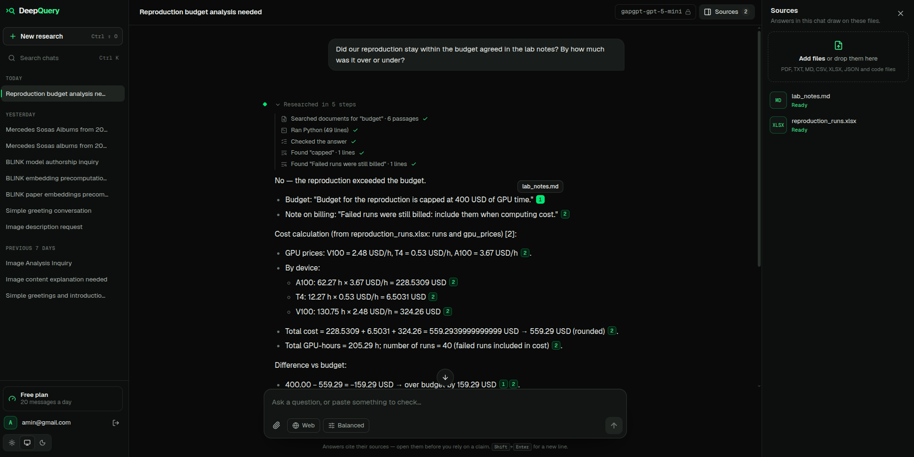
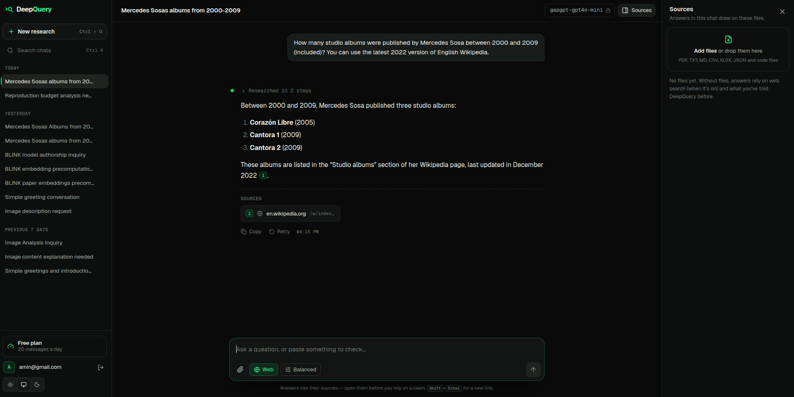
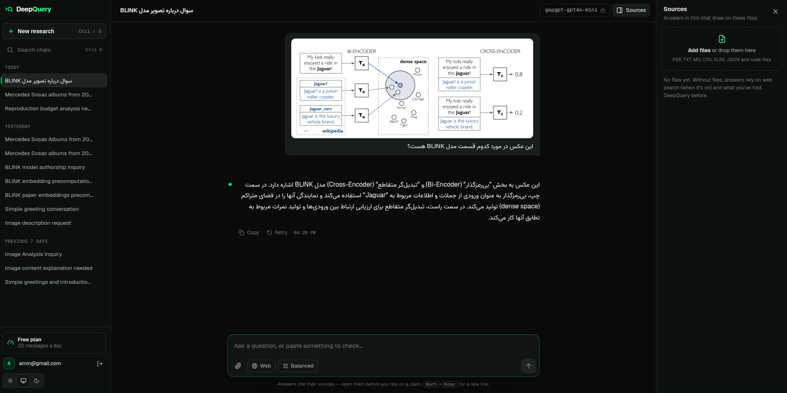
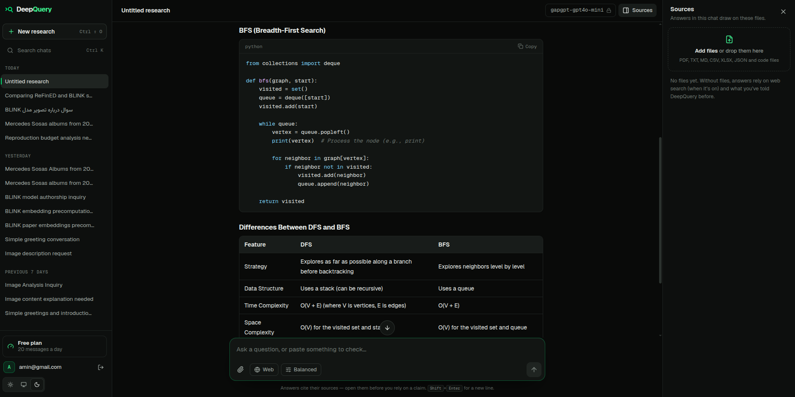
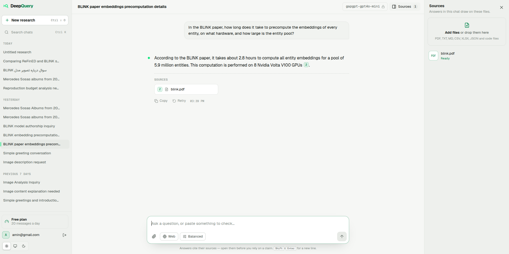
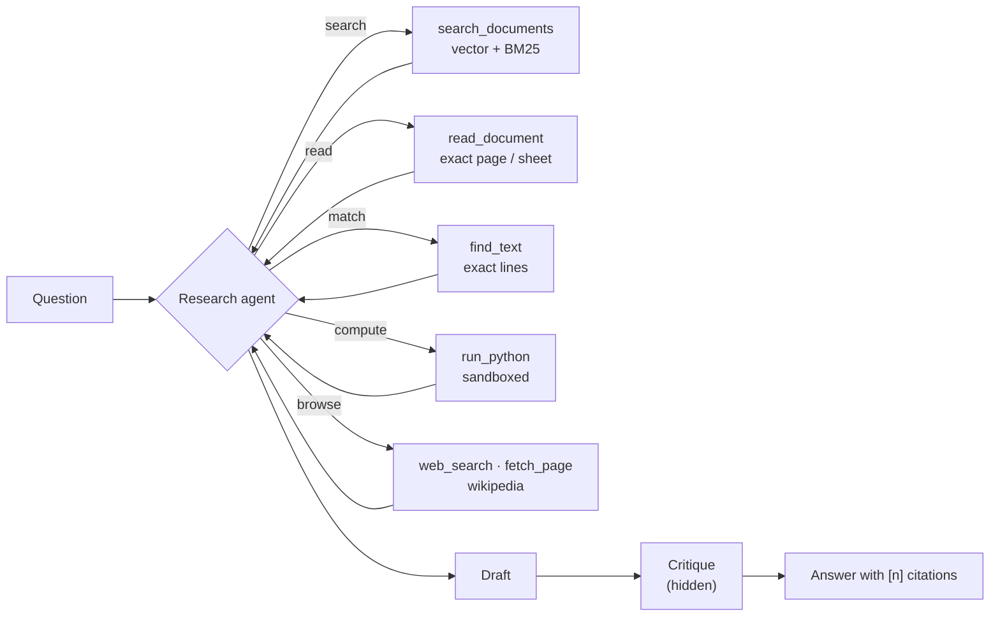

<div align="center">
  

  <h1>DeepQuery</h1>
  <p><strong>A research agent that answers from your documents and the web, and shows its evidence.</strong></p>

  [](https://github.com/AminRezaeeyan/DeepQuery/actions/workflows/ci.yml)
  [-31%2F33-2ea44f?style=flat-square)](#-the-benchmark)
  [](https://www.djangoproject.com/)
  [](https://react.dev/)
  [](https://github.com/pgvector/pgvector)
  [](#-quick-start)
</div>

> [!IMPORTANT]
> **What's new in this version.** DeepQuery started as a RAG chat. It is now a research agent:
>
> - **A research agent** in plain Python with native tool calling: it searches, reads exact pages, matches text, runs code, browses the web and Wikipedia, then **critiques its own draft** before answering.
> - **Code execution** in a sandbox (bubblewrap or a limited subprocess), so every number is copied from a source or computed, never guessed.
> - **Hybrid retrieval**: vector search + BM25 merged by reciprocal rank fusion, page-level chunks, an exact-match tool, and citations down to the page.
> - **A benchmark** of 33 hard research questions with automatic grading. Our run with gpt-5-mini scored **31/33**, and you're invited to beat it.
> - **A new React + TypeScript client** with live research steps, dark and light themes, English and Persian.
> - **Docker Compose** for a one-command setup, and **[technical docs](docs/README.md)** with diagrams for every part.

## 📖 What it does

You upload papers, spreadsheets, notes or code to a chat, optionally turn on web search, and ask
a question. A research agent works it out in steps: it searches your documents, reads the exact
pages and sheets it needs, runs Python for any arithmetic, looks things up on the web or in a
specific Wikipedia revision, and checks its draft against what it read. The answer cites a
source for every claim, down to the page (`refined.pdf, p. 6`), and the steps that led to it stay
with the answer.

<p align="center">
  
  <br/><sub>The agent searched the files, found the exact lines, ran Python and checked its draft. Every number links to its source.</sub>
</p>

<div align="center">

| Start a research | Web and Wikipedia |
| :---: | :---: |
|  |  |
| **Conflicting sources flagged** | **Persian, with an image** |
|  |  |
| **Code and tables** | **Light theme** |
|  |  |
| **Admin: models, plans, activity** | |
|  | |

</div>

## ⚙️ How it works



1. **Ingestion.** Uploads are extracted per PDF page or spreadsheet sheet, split into
   400-token chunks and embedded into PostgreSQL with pgvector, in a Celery worker.
2. **Research.** Each turn the model either calls tools or answers. Tools return numbered
   sources; the user sees one live status line ("Reading refined.pdf, p. 6").
3. **Critique.** A draft that used tools is never shown. The agent first lists its problems
   (each claim paired with the sentence that supports it, numbers re-checked, code tested
   against what it should compute), may use more tools, then writes the final answer.
4. **Answer.** It streams as JSON lines, with a references list of only the sources it cites.

No LangChain or agent framework: the loop, tools, retrieval and prompts are ordinary, tested
Python. The [technical docs](docs/README.md) explain every part and why it's built that way.

## 🏆 The benchmark

DeepQuery ships with its own benchmark, in [`eval/`](eval/README.md). It has **33 questions** over three
real entity-linking papers and a fictional lab's spreadsheets, CSV audit, scripts, notes and
images, in English and Persian. The questions are hard on purpose:

- find one number in a 12-page two-column paper;
- compare the same method across papers that name it differently;
- follow a notes sheet that says which runs to exclude;
- work out what a buggy script prints, and spot the bug;
- read a table from a screenshot or a specific Wikipedia revision;
- notice when lab notes contradict a paper;
- say "the paper doesn't report this" instead of guessing.

`python manage.py run_eval` runs every question through the real pipeline, in a fresh chat, and grades it:

- **numbers**, checked deterministically;
- **retrieval**: did the needed passages reach the model?
- **citations**;
- **a separate judge model**, which checks each key point and flags unsupported claims.

### Results

DeepQuery works with whichever models you configure. For this run we used **gpt-5-mini** to
answer and **gpt-6-luna** as the judge, with `text-embedding-3-small` embeddings:

| Metric | Score |
|---|---|
| **Strict accuracy** (every key point, nothing wrong) | **31 / 33 (93.9%)** |
| Partial credit (share of key points met) | 97.2% |
| Expected numbers found | 100% |
| Needed passages retrieved | 100% |
| Right source cited | 100% |
| Unanswerable questions declined | 3 / 3 |
| Median answer time | 52 s (median 5 agent steps) |

| Category | Strict | Category | Strict |
|---|---|---|---|
| Facts from one paper | 5/5 | Code output | 3/3 |
| Calculations | 4/4 | Web | 3/3 |
| Spreadsheet & CSV | 6/6 | Unanswerable | 3/3 |
| Persian | 2/2 | Image · Conflicting sources | 2/2 |
| **Comparisons across papers** | **3/5** | | |

Details: [docs/evaluation.md](docs/evaluation.md).

> [!TIP]
> **Challenge: reach 33/33.** Everything you need is in the repo: the questions, the sources,
> the runner and the grader. Make the *agent* better, for example with table extraction that
> keeps columns, better planning or a new tool, then open a pull request with your run's report.
> Making the benchmark easier doesn't count. See [CONTRIBUTING.md](CONTRIBUTING.md).

## ✨ Features

**Research**
- Research agent with seven tools: `search_documents`, `read_document`, `find_text`,
  `run_python`, `web_search`, `fetch_page`, `wikipedia`.
- Answer critique before sending (`AGENT_REVIEW`) and configurable reasoning effort for
  reasoning models (`AGENT_REASONING_EFFORT`).
- Citations per page or URL; the references list shows only what the answer cites.
- Documents: PDF, Excel (every sheet), CSV, text, Markdown, JSON and code files.
- Images in questions, for models with vision.
- Web search without an API key (`ddgs`), page reading with SSRF protection, and Wikipedia
  sections, tables and past revisions.
- Memory: recent history in every prompt; personal facts (English or Persian) extracted in the
  background and recalled when relevant. Temporary chats never touch memory.

**Answer settings** (per message): strict quote mode, challenge mode, general or expert audience,
and brief, balanced or deep answers.

**Platform**
- Any OpenAI-compatible API, Anthropic Claude, Google Gemini or Ollama for chat; OpenAI, Gemini
  or local sentence-transformers models for embeddings, all configured in the admin. Providers
  without tool calling answer in a single retrieval pass.
- Embedding-model switches re-embed everything in the background without mixing vectors.
- JWT and Google sign-in, throttled auth, encrypted provider keys, per-user data access.
- Plans with daily limits and ZarinPal payments.
- 300+ server tests (pytest) and a Vitest client suite, run in CI on every push.

## 🚀 Quick start

```bash
git clone https://github.com/AminRezaeeyan/DeepQuery.git
cd DeepQuery
cp server/.env.example server/.env          # set SECRET_KEY at least
docker compose up --build -d
docker compose exec server python manage.py createsuperuser
```

Then:

1. Open http://localhost:8080/admin/ and add an **LLM provider**, e.g. type `openai`, a model
   with tool calling such as `gpt-5-mini`, and your key (any OpenAI-compatible `base_url` works).
2. In the same admin, add an **embedding provider**, e.g. `text-embedding-3-small`, dimension 1536.
3. Open http://localhost:8080, sign up and ask away.

For local development without Docker, see [docs/deployment.md](docs/deployment.md#local-development).

**Run the benchmark:**

```bash
docker compose exec server python manage.py run_eval \
    --provider "<answering model>" --judge-provider "<stronger judge model>"
```

Results land in `eval/runs/<run>/report.md`, with every answer in full.

## 📚 Documentation

| Page | What's in it |
|---|---|
| [Architecture](docs/architecture.md) | Components, data model, request flow, streaming protocol, prompt budgets, memory, providers |
| [The research agent](docs/agent.md) | The loop, native tool calling, the draft → critique → final phases, tools, citations |
| [Retrieval](docs/retrieval.md) | Extraction, chunking, embeddings, hybrid search (BM25 + RRF), exact reading and matching |
| [Code execution](docs/code-execution.md) | The sandbox: namespaces, limits, modes and their honest trade-offs |
| [The benchmark](docs/evaluation.md) | Question design, grading, scoring levels, re-runs, results |
| [Security](docs/security.md) | Prompt injection, SSRF, ownership, secrets, uploads |
| [Deployment](docs/deployment.md) | Docker, local development, configuration reference, CI |

## 🗂️ Project structure

```
server/        Django + DRF API, the research agent (ai_core/agent), Celery tasks, the benchmark runner
client/        React + TypeScript + Vite app
eval/          the benchmark: questions.yaml and sources/ (runs/ stays local)
docs/          technical documentation and images
```

## 🤝 Contributing

Contributions are welcome. The best place to start:

- **beat the benchmark**;
- **add tool calling to another provider** (Claude, Gemini or Ollama only need `stream_turn`);
- **improve table extraction**;
- **pick an issue**.

Please read [CONTRIBUTING.md](CONTRIBUTING.md): it covers the setup, the tests, the commit style
and how to submit a benchmark result.

If DeepQuery is useful to you, a ⭐ helps others find it.
