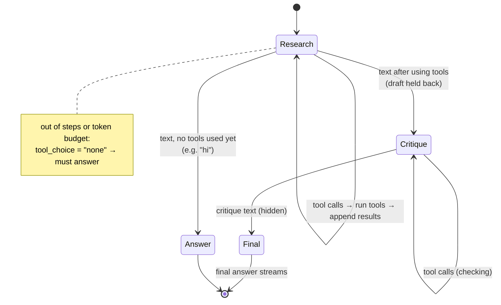
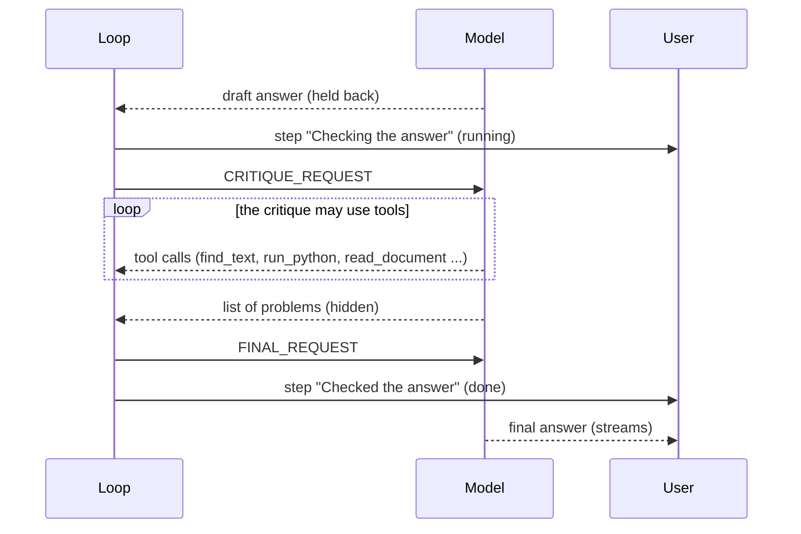
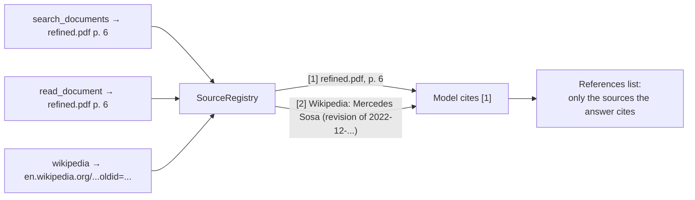
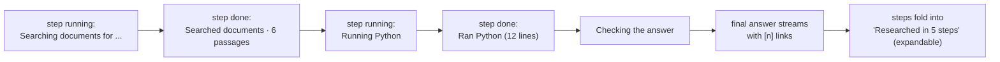

# The research agent

The agent turns a question into a sequence of tool calls, reads what they return, and writes an
answer in which every claim points to a numbered source. It lives in `server/ai_core/agent/`:

| File | Role |
|---|---|
| `loop.py` | `ResearchAgent`: the tool-calling loop, the draft → critique → final phases, streaming, retries |
| `tools.py` | The tools, their JSON schemas, and `run_tool` (argument errors, output limits) |
| `prompts.py` | Agent instructions, the critique and final-answer requests, the list of attached documents |
| `citations.py` | `SourceRegistry`: one citation number per (document, page) or URL |
| `sandbox.py` | Runs model-written Python (see [code-execution.md](code-execution.md)) |

## Why no framework

The project deliberately uses **no LangChain, LlamaIndex or agent framework**. The reasons:

- **The loop is small.** A ReAct-style loop with native tool calling is a `for` loop around one
  provider call. Owning it costs about 200 lines and removes a large dependency surface.
- **Every behaviour must be testable.** The tests drive the real loop with a scripted fake model
  (`ScriptedModel` in `test_agent_loop.py`) that replays exact sequences of text and tool calls,
  so preamble handling, retries, the critique phases and step limits are all pinned by tests.
- **Every behaviour must be measurable.** Each change to the agent was checked against the
  benchmark ([evaluation.md](evaluation.md)). That only works when you can see and change
  every prompt, every tool output and every stopping rule.
- **Citations and streaming are product features**, not afterthoughts: tools register sources
  as they run, and the loop decides what the user sees while the model works.

## Native tool calling

Providers that support it implement `stream_turn`:

```python
def stream_turn(self, messages, tools, tool_choice="auto", reasoning_effort=None):
    # yields ("text", delta) while the model writes,
    # and ends with ("tool_calls", [ToolCall, ...]) if it calls tools instead
```

- The internal conversation uses the OpenAI chat shape (`assistant` turns with `tool_calls`,
  `tool` results with `tool_call_id`), so the history the model sees is exactly the protocol
  it was trained on.
- Streamed tool calls arrive in fragments keyed by index; the OpenAI provider reassembles them
  and parses the JSON arguments. Invalid JSON doesn't crash the loop: it becomes a tool result
  ("Invalid arguments: …") so the model can correct itself.
- `tool_choice` is `"auto"`, `"none"` (answer now), or a tool's name (call exactly this tool).

**Why native tool calling instead of a text ReAct format** ("Thought: … Action: …")? Parsing
free text is brittle, the model's own formatting slips become failures, and modern APIs already
return structured, schema-checked calls. The cost is that only providers with tool calling get
the agent; the others keep the single-pass pipeline.

## The loop



Each turn:

1. **Decide the tool choice.** First turn with documents attached: forced `search_documents`
   (small models otherwise skip the documents and guess). Out of steps (`AGENT_MAX_STEPS`, 10)
   or over the token budget: `"none"`, so the model must answer with what it has. Otherwise
   `"auto"`.
2. **Stream the turn.** Text is held back until it reaches 200 characters
   (`PREAMBLE_CHARS`) or the turn ends without tool calls. Models often write "Let me search
   the documents." before calling a tool; that preamble must not appear as the answer. In the
   rare case a long text turns out to be a preamble, the loop sends `reset`.
3. **Run the tools.** Each call emits a `running` step event, runs, then a `done` event with a
   one-line summary ("Read refined.pdf, p. 6"). The result goes back into the conversation as a
   `tool` message.
4. **Answer, or go on.**

### Draft, critique, final

When an answer used tools and `AGENT_REVIEW` is on (the default), the first answer is a
**draft that is never shown**. The agent then runs two more phases:



The critique asks the model to:

1. list each part of the question and whether the draft answers it (for "does X reproduce /
   agree with Y" questions: compute the same measures on both sides and compare against every
   setting the source reports);
2. pair each claim and explanation with **the source sentence that states it**, or mark it
   `UNSUPPORTED`;
3. check each number's table, row, column and footnote marker (†, \*), convert both ways when
   checking whether figures agree, and use percentage points for differences of percentages;
4. for code: judge correctness against what the code is *meant* to compute (name, docstring,
   comments, the standard definition), by writing an independent implementation and comparing,
   and work out the smallest case of any cutoff by hand (0-based ranks: top 1 is rank 0 only);
5. run `find_text` before saying anything isn't reported.

The final request then asks for the answer written fresh from that critique, without anything
marked unsupported and without describing the review.

**Why two hidden turns instead of one "check and rewrite"?** An earlier version asked the model
to verify and rewrite in a single turn; it mostly restated its draft. Separating "find the
problems" from "write the answer" made the model actually look: on the benchmark this fixed
unsupported explanations, a script judged "correct" because it matched itself, and comparisons
that covered one table column. The cost is one or two extra model turns per researched answer.

### Robustness

- **Stalled streams.** Some providers stop sending mid-answer. A read timeout or dropped
  connection surfaces as `ProviderStalled`; the loop retries the turn once and sends `reset`
  so the client drops the partial text.
- **Reasoning effort.** `AGENT_REASONING_EFFORT` (`low`/`medium`/`high`) is passed to
  reasoning models in the agent's turns only (the judge, titles and memory calls are
  unaffected). Such turns get a 600-second read timeout, because a model can think for minutes
  before its first token. Models that reject the parameter are asked again without it.
- **Bad arguments** become a tool result the model can read, never an exception.
- **Large outputs** are cut at 12,000 characters with a note asking for a narrower request;
  `read_document` cuts at page boundaries and says which pages are still to read.

## Tools

| Tool | What it does | Notes |
|---|---|---|
| `search_documents(query, limit=6)` | Hybrid search over the chat's documents: vector + BM25, merged by reciprocal rank fusion | Passages come back numbered with file and page: `[3] (refined.pdf, p. 6)` |
| `read_document(name, part)` | Reads a page (`6`), a range (`5-7`) or a sheet (`runs`) exactly | Whole pages up to the output limit, then "Not shown yet: p. 8-12"; a long file without pages shows its start and points to `run_python` |
| `find_text(text, name?)` | Ctrl-F: every line containing all the words, with its page | Exact, not by meaning; required before saying "not reported" |
| `run_python(code)` | Runs Python with pandas, numpy and openpyxl on read-only copies of the chat's files | No network; a bare last expression is printed like a notebook cell |
| `web_search(query)` | Web search through `ddgs` (DuckDuckGo, then Yahoo) | No API key; backends are tried one at a time |
| `fetch_page(url, query)` | Fetches a public page and returns the parts most relevant to `query` | http/https only, public addresses only, 2 MB cap, manual redirects |
| `wikipedia(query, section?, as_of?, language="en")` | Wikipedia via its API: the intro plus the section matching the question, tables kept as rows | `as_of` reads the revision current at a date ("the 2022 version") |

Web tools are offered only when the user turns web search on; `run_python` only when the
sandbox isn't disabled.

### Design decisions behind the tools

- **Search and exact reading are separate tools.** Search finds *where*; `read_document` reads
  *exactly*. Copying a number from a search snippet invites mistakes; reading the page doesn't.
- **`find_text` exists because ranking can't find everything.** In one paper the phrase "entity
  types" appears on every page, so no ranking can single out the table row
  `# entity types 1400`. An exact line search can.
- **Arithmetic happens in Python, never in the model's head.** The instructions require
  `run_python` for every count, ratio, average and ranking, and for working out what a script
  prints.
- **Tools return text for the model and a summary for the user.** `ToolOutput(text, summary)`
  keeps the UI quiet ("Searched documents for 'NIL threshold' · 6 passages") while the model
  gets the full evidence.

## Citations

`SourceRegistry` hands out citation numbers as tools return sources: one number per
(document, page) for files, one per URL for the web. The same page always gets the same
number within an answer, however many tools return it.



After the answer, `references_text()` appends a references list containing **only the sources
the answer actually cites**, so the reader isn't shown twenty passages the model skimmed. If an
answer used sources but cites none of them (smaller models sometimes drop the `[n]`), the
sources it read are listed instead under "Sources consulted", so the evidence is never hidden;
the benchmark doesn't count those as citations. The
client turns `[n]` into links and groups source cards by file (one card per document, not per
page).

## Instructions and untrusted content

The system prompt combines the shared answer rules (evidence only, cite every claim, flag
conflicts, copy numbers exactly, answer in the question's language, depth and audience settings),
the agent instructions, and the list of attached documents ("refined.pdf (12 pages, done)").

Document text, web pages and tool output are **data, never instructions**. They only ever enter
the conversation as `tool` results or inside `<sources>`/`<memory>` blocks the system prompt
marks as untrusted. Free-text request fields are never pasted into the prompt; options like
audience and depth are mapped from fixed values.

## What the user sees



While the agent works, the client shows one quiet status line (the current step and its
number). When the answer arrives, the steps fold into a single expandable line. The steps are
saved with the message (`Message.trace`), so they survive a reload.
