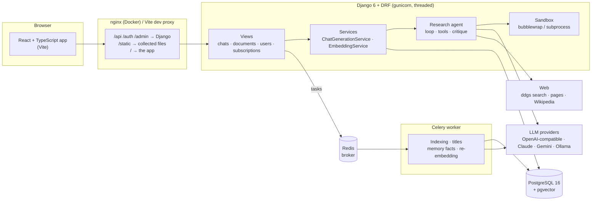
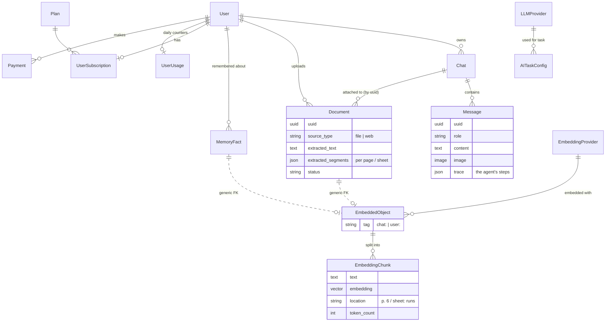
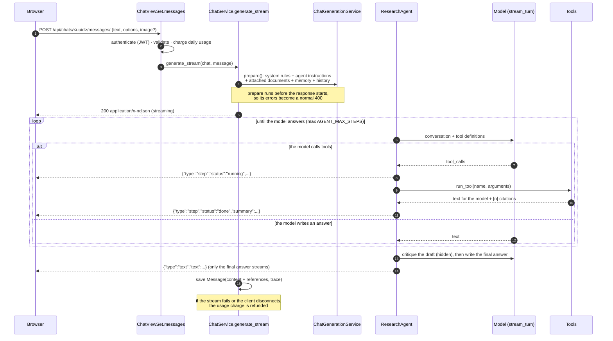
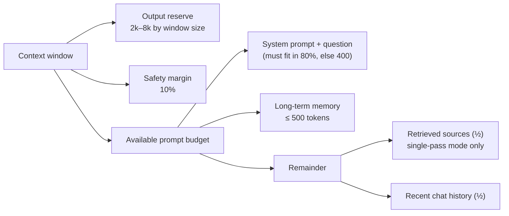

# Architecture

DeepQuery is a Django REST API, a Celery worker and a React single-page app around one idea: a
research agent that answers from your documents and the web, and shows its evidence. This page
explains how the pieces fit together and why they are built the way they are. The agent, the
retrieval pipeline, code execution and the benchmark each have their own page.

## The system at a glance



| Part | Technology | Responsibility |
|---|---|---|
| Client | React 19, TypeScript, Vite, Vitest | Chat workspace, live research steps, citations and source cards, dark/light themes, English and Persian (RTL-aware) text |
| API | Django 6, Django REST Framework, SimpleJWT, drf-spectacular | Auth, chats and messages, document uploads, plans and payments, the streaming answer endpoint, OpenAPI docs at `/api/docs/` |
| Agent | Plain Python (`server/ai_core/agent/`) | The tool-calling loop, tools, citation numbering, answer critique |
| Retrieval | pgvector, BM25 in Python, pypdfium2, pandas/openpyxl | Text extraction per page/sheet, chunking, embeddings, hybrid search |
| Background jobs | Celery 5 + Redis | Document indexing, chat titles, long-term memory facts, embedding-model downloads and re-embedding |
| Database | PostgreSQL 16 + pgvector | Relational data and vectors in one store |
| Code execution | bubblewrap or a limited subprocess | Running model-written Python on the chat's files |

### Why this shape

- **One database for rows and vectors.** pgvector keeps embeddings next to the documents,
  chats and users they belong to, so a vector query can be filtered by owner and chat in the
  same SQL statement, deleted with a cascade, and backed up with everything else. A separate
  vector database would add a second consistency problem for no gain at this scale.
- **Services hold logic, views stay thin.** Views authenticate, validate and charge usage;
  `ChatGenerationService`, `EmbeddingService` and the agent do the work. That keeps the agent
  usable outside HTTP: the benchmark runner drives the exact same code path.
- **Slow work goes to Celery.** Extracting and embedding a 12-page PDF takes seconds; it must
  not block a request. The upload returns at once and the document moves through
  `pending → processing → done/failed`.
- **No agent framework.** The loop, tools, prompt building and chunking are ordinary Python
  (about 1,000 lines for the agent). Every behaviour is visible, testable with a scripted fake
  model, and measurable with the benchmark. See [agent.md](agent.md#why-no-framework).

## Repository layout

```
server/                  Django project
  deepquery/             settings, URLs, Celery app
  users/                 email-based User, JWT and Google sign-in
  chats/                 Chat, Message, the streaming endpoint, chat titles
  documents/             Document, text extraction, the indexing task
  ai_core/
    agent/               loop.py · tools.py · prompts.py · citations.py · sandbox.py
    llm_providers/       one class per provider, registered with @register_provider
    embedding_providers/ one class per provider, registered with @register_embedding_provider
    services/            chat_service (prompts) · embedding_service (chunking, search)
                         web_search_service · memory/ · token_service
  subscriptions/         plans, daily usage limits, ZarinPal payments
  evaluation/            the run_eval command: answers and grades the benchmark
client/                  React app (features/chat/Workspace.tsx is the main screen)
eval/                    the benchmark: questions.yaml, sources/, runs/ (local)
docs/                    these pages
```

## Data model



Design notes:

- **Embeddings attach to anything.** `EmbeddedObject` points at its source through a generic
  foreign key, so documents, fetched web pages and memory facts share one search path. The
  `tag` scopes a search: `chat:<id>` for a chat's documents and pages, `user:<id>` for a user's
  memory facts.
- **Chunks remember where they came from.** `EmbeddingChunk.location` ("p. 6", "sheet: runs")
  lets every citation name the page, which is what makes an answer checkable.
- **Documents keep their segments.** `Document.extracted_segments` stores the text per page or
  sheet, so the agent can read page 6 exactly instead of relying on search snippets.
- **Messages keep their research trail.** `Message.trace` stores the agent's steps (tool,
  arguments, one-line summary) so a reloaded chat still shows how an answer was found.
- **Soft deletes for chats and messages** (`is_deleted`, `deleted_at`), with a manager that
  hides them, so history is recoverable and pagination stays stable.
- **Provider API keys are encrypted at rest** with Fernet (`ai_core/fields.py`), using
  `FIELD_ENCRYPTION_KEY` or a key derived from `SECRET_KEY`.

## How a message flows



The endpoint returns `application/x-ndjson`: one JSON object per line.

| Event | Meaning |
|---|---|
| `{"type": "step", "id", "tool", "arguments", "status": "running" \| "done", "summary"}` | A tool call starting and finishing. The client shows one live status line, then folds the steps into "Researched in N steps". |
| `{"type": "text", "text"}` | Part of the answer. |
| `{"type": "reset"}` | Drop the text streamed so far (a retried turn after a stalled stream). |
| `{"type": "error", "detail"}` | The answer stopped; the client offers Retry. |

Tool *outputs* never leave the server; the client gets only the one-line summaries. The full
outputs stay available to the benchmark, which grades against what the model actually read.

**Why NDJSON over a streaming response, not WebSockets or SSE?** The answer is a single
request/response with a body that arrives in parts. A `fetch` stream reader is enough on the
client, it works through any HTTP proxy, it needs no extra server process (Channels/ASGI), and
the same events are trivial to consume from Python in tests and in the benchmark. The cost is
that streaming holds a worker thread for the length of an answer, which is why gunicorn runs
threaded workers.

**Usage is charged before streaming and refunded on failure.** `charge()` counts the message
(and image) against the plan's daily limits and returns a `refund` function; the stream's
`finally` block calls it if the answer didn't complete, including when the browser disconnects
(`GeneratorExit`).

## Prompt budgets

Every model has a context window (`LLMProvider.max_context_tokens`). `TokenService` counts tokens
with tiktoken's `cl100k_base` (a close-enough estimate across providers) and the prompt builder
splits the room:



In agent mode there is no up-front retrieval: the agent fetches what it needs, and the loop
stops offering tools once the conversation passes the budget, forcing an answer with what it
has (see [agent.md](agent.md#the-loop)).

## Memory

- **Short-term:** the most recent messages of the chat that fit the history budget
  (`ShortTermMemory`), oldest first, so follow-up questions work.
- **Long-term:** after each message a Celery task (`extract_and_embed_facts_task`) asks a model
  to extract durable personal facts ("I'm writing my thesis on entity linking"), in English or
  Persian, and embeds them under `user:<id>`. Later questions retrieve facts with cosine
  similarity ≥ 0.5 and add them inside a `<memory>` block that the system prompt marks as
  untrusted data.
- **Temporary chats** (`Chat.is_temporary`) neither read nor write long-term memory. The
  benchmark uses them so questions stay independent.

## Providers

LLM and embedding providers are configured in the admin, not in code, and selected per task
(`AITaskConfig`: chat, titles, memory, search queries). Each provider type is a class registered
with a decorator:

```python
@register_provider("openai")
class OpenAIProvider(LLMProviderBase):
    supports_tools = True
    def stream(self, messages, image_bytes=None, mime_type=None): ...
    def stream_turn(self, messages, tools, tool_choice="auto", reasoning_effort=None): ...
```

| Type | Chat | Tool calling (agent) | Vision |
|---|---|---|---|
| `openai` (any OpenAI-compatible API, e.g. gapgpt) | ✓ | ✓ | ✓ |
| `claude` | ✓ | — (single-pass answers) | ✓ |
| `gemini` | ✓ | — (single-pass answers) | ✓ |
| `ollama` | ✓ | — (single-pass answers) | ✓ |

Providers without `supports_tools` fall back to the **single-pass pipeline**: retrieve once
(`DocumentRAGService` and, with web search on, `WebKnowledgeService`), put the sources in the
prompt, answer. Adding tool calling to another provider means implementing `stream_turn`; the
agent needs nothing else.

Embedding providers (`openai`, `gemini`, `hf_local` with sentence-transformers) follow the same
pattern. **Switching the embedding model is safe**: the new provider becomes *active* while the
old one keeps *serving* searches; a Celery task re-embeds every object, then the switch flips
(`finish_provider_switch`). Searches always compare vectors from the same model
(`eo.provider_id = %s` in the SQL), so results are never mixed across models mid-switch.

## Authentication and accounts

- Email-based `User` (no usernames). Sign-up and sign-in return JWTs (SimpleJWT: 60-minute
  access token, 1-day refresh token). The client refreshes once on a 401 and retries.
- Google sign-in verifies the ID token server-side with `google-auth` and is enabled only when
  `GOOGLE_CLIENT_ID` is set.
- Auth endpoints are throttled (`AUTH_THROTTLE_RATE`, 10/minute by default) and passwords go
  through Django's validators.
- Every endpoint requires authentication unless it opts out, and every query that returns or
  changes user data filters by the requesting user (chats, messages, documents and the
  owner-only image endpoint `/api/messages/<uuid>/image/`).

## Plans and payments

`Plan` defines daily limits for messages, documents and images; `UserUsage` counts them and
resets daily. Payments go through ZarinPal (sandbox by default): `payment/initiate/` creates a
pending `Payment` and redirects; `payment/verify/` confirms with ZarinPal and creates or extends
the user's `UserSubscription`.

## Further reading

- [The research agent](agent.md): the loop, tools, critique, citations, streaming
- [Retrieval](retrieval.md): extraction, chunking, hybrid search
- [Code execution](code-execution.md): the sandbox and its limits
- [The benchmark](evaluation.md): questions, grading, scoring, results
- [Security](security.md): the threat model and the defences
- [Deployment](deployment.md): Docker, configuration, local development
