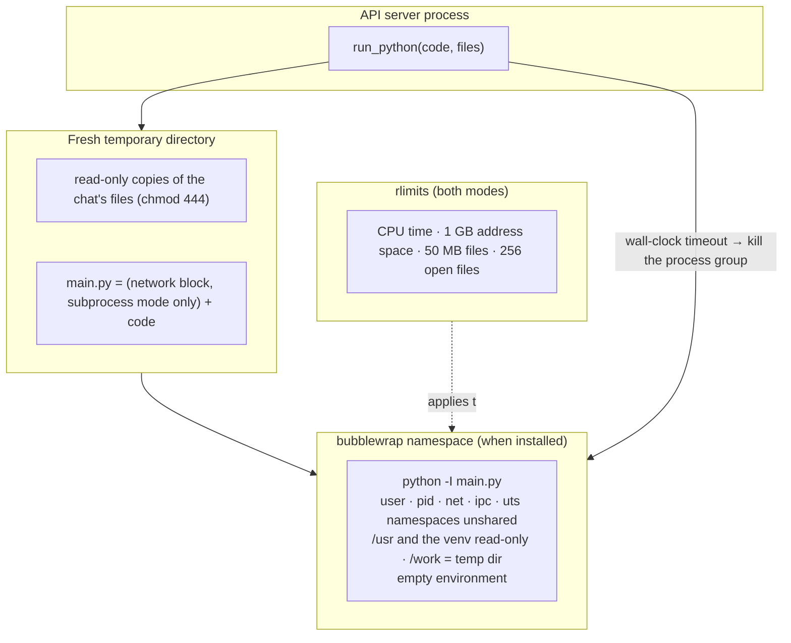

# Code execution

The agent's `run_python` tool runs model-written Python for arithmetic, table statistics and
working out what a script prints. Language models are unreliable calculators: in early
benchmark runs the model divided 600 by 120 and got 15, and misjudged a script's output by a
factor of four. With `run_python`, every number in an answer is either copied from a source or
printed by code.

Running code a language model wrote, on files a user uploaded, is running untrusted code. This
page describes how it is contained (`server/ai_core/agent/sandbox.py`).

## What the code can do

- Python 3 with **pandas, numpy and openpyxl**.
- The chat's attached files are in its working directory under their names, as **read-only
  copies**: `pd.read_csv("nil_audit.csv")`, `runpy.run_path("recall_at_k.py")`.
- Only what it prints comes back. As in a notebook, a bare expression on the last line is
  printed for it (`df.describe()` works without `print`).
- Output is cut at 8,000 characters; the tool reports the exit code or "stopped: took too long".

## Layers of containment



| Layer | bubblewrap mode | subprocess mode |
|---|---|---|
| Filesystem | Sees only `/usr`, the Python environment (read-only) and its working directory. The server's code, `.env` and other users' files don't exist inside. | Runs in a temporary directory, **but can read any file the server user can read**. |
| Network | No network namespace: there is no network at all | Socket connect, `create_connection` and `getaddrinfo` are patched to raise before the code runs (best effort) |
| Environment | `--clearenv`: only `HOME`, `PATH` and thread limits | A minimal environment (no secrets inherited) |
| Processes | New PID namespace, `--die-with-parent`, new session | New session; the whole process group is killed on timeout |
| CPU / memory / disk | `RLIMIT_CPU` (timeout + 1 s), `RLIMIT_AS` (`CODE_MEMORY_MB`, 1 GB), `RLIMIT_FSIZE` (50 MB), `RLIMIT_NOFILE` (256) | same |
| Time | `CODE_TIMEOUT` (20 s) wall clock, then `SIGKILL` to the process group | same |
| Python | `-I` (isolated mode: ignores `PYTHON*` environment variables and the user site directory) | same |

The bubblewrap command (abridged):

```bash
bwrap --die-with-parent --unshare-all --new-session \
      --ro-bind /usr /usr --symlink usr/bin /bin --symlink usr/lib /lib --symlink usr/lib64 /lib64 \
      --ro-bind "$VENV" "$VENV" --proc /proc --dev /dev --tmpfs /tmp \
      --bind "$WORKDIR" /work --chdir /work \
      --clearenv --setenv HOME /work --setenv PATH /usr/bin \
      --setenv OPENBLAS_NUM_THREADS 1 --setenv OMP_NUM_THREADS 1 --setenv MPLBACKEND Agg \
      "$PYTHON" -I main.py
```

## Modes

`CODE_SANDBOX` selects the mode:

| Value | Meaning |
|---|---|
| `auto` (default) | bubblewrap if `bwrap` is installed, otherwise subprocess |
| `bwrap` | always bubblewrap |
| `subprocess` | the limited subprocess |
| `off` | no code execution: `run_python` is not offered to the model |

**Be honest about the fallback.** The subprocess mode limits time, memory, file size and
(best effort) network, but it does **not** isolate the filesystem. Use bubblewrap
(`sudo apt install bubblewrap`) or run the server in a container anywhere users aren't
trusted.

**In Docker**, bubblewrap needs user namespaces that a default container doesn't allow, so the
Compose file sets `CODE_SANDBOX=subprocess`. The container is then the isolation boundary:
the code can read what the container can read (the application code and its uploads volume),
but not the host. The server runs as an unprivileged user inside the container. For stronger
isolation in production, run code execution in a separate, network-less container or a gVisor
/ Firecracker sandbox.

## Why a subprocess and not a hosted sandbox

A hosted code-execution service or a microVM would isolate better, but adds an external
dependency, latency and cost for every calculation. The project's requirement was "good enough
containment, no external service": bubblewrap gives namespace isolation on any Linux host
without root, and the subprocess mode keeps the feature working on machines without it.

## Tests

`server/ai_core/tests/test_sandbox.py` runs each check in both modes (the bubblewrap ones are
skipped where `bwrap` isn't installed):

- results come back and files are read-only;
- runaway code is stopped by the timeout;
- network connections fail;
- the server's environment variables are not visible;
- under bubblewrap, the server's own files don't exist;
- a bare last expression is printed, and parsing model code never prints warnings into the
  server log.
