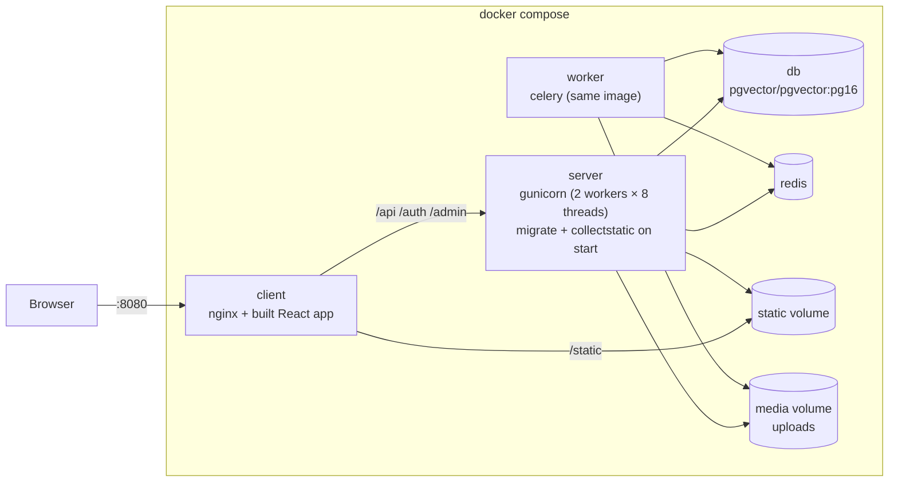

# Deployment

## Docker (recommended)

```bash
git clone https://github.com/aminrezaeeyan/DeepQuery.git
cd DeepQuery
cp server/.env.example server/.env        # set SECRET_KEY at least
docker compose up --build -d
docker compose exec server python manage.py createsuperuser
```

Open **http://localhost:8080**. The admin is at **http://localhost:8080/admin/**: add an LLM
provider and an embedding provider there (see [Configure models](#configure-models)), then sign
up in the app and start a chat.

### What runs



| Service | Image | Notes |
|---|---|---|
| `client` | built from `client/Dockerfile` (Node 22 build → nginx 1.27) | Serves the app, proxies `/api`, `/auth`, `/admin` to Django with buffering off (answers stream), serves the admin's static files |
| `server` | built from `server/Dockerfile` (Python 3.12, CPU-only PyTorch) | Runs as an unprivileged user; waits for PostgreSQL, migrates, collects static files, starts gunicorn |
| `worker` | the same image | `celery -A deepquery worker`: indexing, titles, memory facts, re-embedding |
| `db` | `pgvector/pgvector:pg16` | Data in the `postgres` volume |
| `redis` | `redis:7-alpine` | Celery broker |

Volumes: `postgres` (database), `media` (uploads), `static` (admin files), `tiktoken`
(tokenizer cache). The repository's `eval/` folder is mounted into the `server` container, so
`run_eval` reads the benchmark and writes its runs to `eval/runs/` on your machine. (The image
has no git history, so runs started in Docker record their commit as `unknown`.)

### Docker-specific settings

Compose reads `server/.env` and overrides what must point at the other containers:

| Variable | Value in Compose | Why |
|---|---|---|
| `DB_HOST`, `CELERY_BROKER_URL` | `db`, `redis://redis:6379/0` | container names |
| `DEBUG` | `False` unless you set it | production defaults |
| `ALLOWED_HOSTS` | `localhost,127.0.0.1,server` | the app is served on localhost |
| `CLIENT_URL` | `http://localhost:8080` | payment redirects |
| `CODE_SANDBOX` | `subprocess` | bubblewrap needs privileges a container doesn't have; see [code-execution.md](code-execution.md#modes) |
| `PORT` | `8080` | the published port of the `client` service |
| `VITE_GOOGLE_CLIENT_ID` | empty | set it (in your shell or a root `.env`) before building to show Google sign-in |

The database container takes `DB_NAME`, `DB_USER` and `DB_PASSWORD` from your shell or a root
`.env` file; the defaults match `server/.env.example`. If you change them, change both.

### Useful commands

```bash
docker compose logs -f server worker        # follow the logs
docker compose exec server python manage.py run_eval --provider "<model>" --judge-provider "<judge>"
docker compose down                         # stop (data stays in the volumes)
docker compose down -v                      # stop and delete all data
```

## Local development

Requirements: Python 3.10+ (3.12 recommended), Node.js 20+, PostgreSQL with pgvector
(`sudo apt install postgresql-16-pgvector`), Redis.

```bash
cd server
python -m venv venv && source venv/bin/activate
pip install torch --index-url https://download.pytorch.org/whl/cpu   # optional: CPU-only PyTorch
pip install -r requirements.txt
pip install --no-deps -r requirements-nodeps.txt
cp .env.example .env
python manage.py migrate
python manage.py createsuperuser
python manage.py runserver                      # API on :8000

celery -A deepquery worker -l info              # second terminal

cd ../client && npm install && npm run dev      # third terminal: app on :5173
```

In development Vite proxies `/api` and `/auth` to `127.0.0.1:8000`, so the app is same-origin
and needs no CORS setup.

**Why `requirements-nodeps.txt`?** `zarinpal-py-sdk` declares exact pins on `setuptools`,
`pytest` and `requests-mock` that it doesn't use. Installed normally, its `setuptools` pin
conflicts with current PyTorch and pip falls back to an old, CUDA-only torch with several GB of
NVIDIA libraries. Installing it with `--no-deps` avoids that.

Optional: `sudo apt install bubblewrap` isolates the agent's code execution
([code-execution.md](code-execution.md)).

## Configure models

In the admin:

1. **LLM provider.** For example type `openai`, your API key, a model such as `gpt-5-mini`,
   and a `base_url` for any OpenAI-compatible API. Set `max_context_tokens` and
   `supports_vision` to match the model. The first provider is used for every task (chat,
   titles, memory, search queries); change that under *AI task configs*. Only providers with
   tool calling (`openai`) run the research agent; others answer in a single retrieval pass.
2. **Embedding provider.** For example `openai` with `text-embedding-3-small`, dimension
   1536. The first one becomes active and serving. Switching later re-embeds everything in the
   background.

## Configuration reference

All settings are environment variables (`server/.env`), read with `python-decouple`.

| Variable | Default | Meaning |
|---|---|---|
| `SECRET_KEY` | insecure placeholder | Django secret; **set it** |
| `DEBUG` | `False` | Never `True` in production |
| `FIELD_ENCRYPTION_KEY` | derived from `SECRET_KEY` | Fernet key that encrypts provider API keys |
| `ALLOWED_HOSTS`, `CORS_ALLOWED_ORIGINS` | — | Comma-separated |
| `DB_NAME`, `DB_USER`, `DB_PASSWORD`, `DB_HOST`, `DB_PORT` | `deepquery`, `deepquery_user`, `deepquery_dev`, `localhost`, `5432` | PostgreSQL |
| `CELERY_BROKER_URL` | `redis://localhost:6379/0` | Redis |
| `MEDIA_ROOT`, `STATIC_ROOT` | `server/`, `server/staticfiles` | Uploads and collected static files |
| `TIKTOKEN_CACHE_DIR` | — | Keep the tokenizer file locally instead of downloading it |
| `AUTH_THROTTLE_RATE` | `10/minute` | Sign-in, sign-up and token refresh |
| `GOOGLE_CLIENT_ID` | — | Enables Google sign-in |
| `WEB_SEARCH_BACKENDS`, `WEB_SEARCH_TIMEOUT` | `duckduckgo,yahoo`, `10` | ddgs backends, tried in order |
| `RAG_CHUNK_TOKENS`, `RAG_CHUNK_OVERLAP_TOKENS` | `400`, `60` | Chunk size and overlap |
| `AGENT_MAX_STEPS` | `10` | Tool-calling turns before the agent must answer |
| `AGENT_REVIEW` | `True` | Critique the draft, then write the final answer |
| `AGENT_REASONING_EFFORT` | — | `low`/`medium`/`high` for reasoning models in agent turns |
| `CODE_SANDBOX` | `auto` | `auto`, `bwrap`, `subprocess` or `off` |
| `CODE_TIMEOUT`, `CODE_MEMORY_MB` | `20`, `1024` | Limits for `run_python` |
| `DOCUMENT_MAX_UPLOAD_MB`, `CHAT_IMAGE_MAX_UPLOAD_MB` | `20`, `10` | Upload limits |
| `ZARINPAL_MERCHANT_ID`, `ZARINPAL_ACCESS_TOKEN`, `ZARINPAL_SANDBOX` | —, —, `True` | Payments |
| `CLIENT_URL` | `http://localhost:5173` | Where payment redirects return |
| `LOG_LEVEL` | `INFO` | Root log level |

## Continuous integration

`.github/workflows/ci.yml` runs on every push and pull request:

- **server:** PostgreSQL with pgvector and Redis as services, CPU-only PyTorch, the requirements,
  a missing-migrations check, then the full `pytest` suite;
- **client:** `npm ci`, type check, Vitest, production build.
