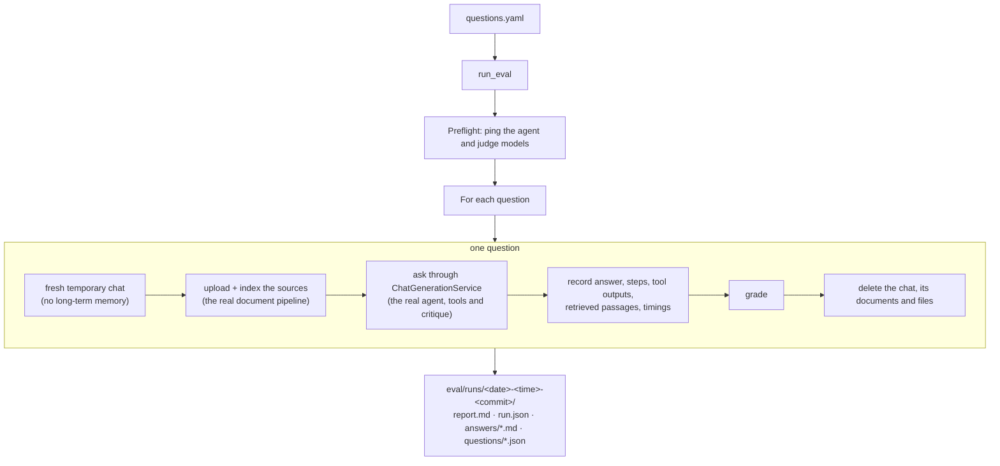
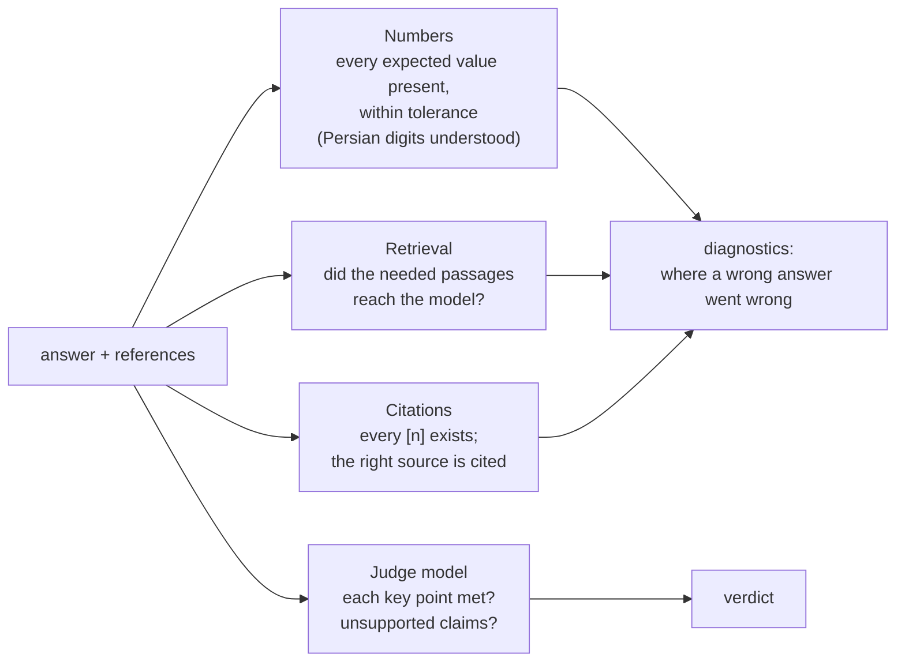

# The DeepQuery benchmark

A research assistant is only useful if its answers are right and checkable. "It looks good in
a demo" is not a measurement, so DeepQuery ships with its own benchmark: 33 hard questions over
real papers and messy lab files, a runner that drives the real answer pipeline, and a grader
that checks numbers, retrieval, citations and every key point. Every change to the agent in
this project was measured with it.

The benchmark lives in [`eval/`](../eval/README.md); the runner in `server/evaluation/`.

## What it tests

The sources are three real entity-linking papers and a set of files describing a fictional lab
that reproduces them. Because the lab is fictional, answers about it can only come from the
files, never from the model's memory.

| Source | What it is |
|---|---|
| `refined.pdf`, `blink.pdf`, `nil-prediction.pdf` | Real papers (ReFinED, BLINK, NIL prediction), two-column PDFs with dense tables |
| `reproduction_runs.xlsx` | Runs per system, dataset and seed; GPU hours and prices on another sheet; a notes sheet saying failed runs are excluded from averages but still billed |
| `nil_audit.csv` | 240 mentions in English and Persian with gold labels and two models' predictions |
| `nil_threshold.py`, `recall_at_k.py`, `latency_estimate.ts` | Short programs whose output (and bugs) the agent must work out |
| `lab_notes.md`, `yaddasht-ha.md` | Meeting notes in English and Persian; the English notes make a claim the papers contradict |
| `throughput_chart.png`, `refined_table5.png` | A chart and a table screenshot, attached as images |

| Category | Questions | What makes them hard |
|---|---|---|
| Spreadsheet & CSV | 6 | Reading every sheet, following the notes sheet's exclusions, exact statistics |
| Facts from one paper | 5 | Finding one sentence or table cell in 12 pages |
| Comparisons across papers | 5 | The same method named differently in each paper, tables with two header rows, footnote markers that change what a number means |
| Calculations from paper data | 4 | Combining table values correctly, checking whether a paper's own numbers agree |
| Code output | 3 | Running code (including TypeScript, translated), spotting an off-by-one bug |
| Web | 3 | Searching, reading a specific Wikipedia revision |
| Unanswerable | 3 | Saying "the paper doesn't report this" instead of borrowing a nearby number |
| Persian | 2 (+1 Persian CSV question) | Answering in Persian from Persian notes and data |
| Image | 1 | Reading a table from a screenshot |
| Conflicting sources | 1 | Noticing that the lab notes contradict a paper |

Each question also lists the **capabilities** it needs (`retrieval` 32, `computation` 21,
`table_reading` 14, `multi_doc` 10, …), so a low score can be traced to a missing capability
rather than guessed at.

### Anatomy of a question

```yaml
- id: q03
  category: paper_fact
  question: >
    Describe the NEL dataset from the NIL prediction paper: how many positive and negative
    examples does it have, what is its inter-annotator agreement, and how many candidate
    entities does a mention have on average?
  sources: [nil-prediction.pdf]          # uploaded into a fresh chat
  answer: >                              # the reference answer
    6,593 positive and 3,331 negative examples (...), 94.61% inter-annotator agreement,
    and 3.80 candidate entities per mention on average.
  grading:
    numbers: [{value: 6593, tol: 0}, {value: 3331, tol: 0}, {value: 94.61, tol: 0.01}, ...]
    key_points: ["6,593 positive examples", "3,331 negative examples", ...]
  cite: [nil-prediction.pdf]             # the source a good answer cites
  evidence:                              # passages that must reach the model
    nil-prediction.pdf: ["6,593 positive examples", "94.61%"]
  requires: [retrieval]
```

## How a run works



The runner uses the **same code path as the web app**: the questions go through
`ChatGenerationService` and the agent, with the same tools and prompts. Nothing is mocked. Each
question gets a temporary chat for a dedicated eval user, so long-term memory is never read or
written and questions can't influence each other.

## Grading



- **Numbers** are checked deterministically: every expected value must appear in the answer
  within its tolerance. Persian digits and separators are normalised first.
- **Retrieval** is scored on the text that actually reached the model (the tool outputs),
  not on which files were opened: a question's `evidence` passages must be in it.
- **Citations**: every `[n]` must exist, and the answer must cite the expected source.
- **The judge** is a separate, stronger model (`--judge-provider`). It sees the question, the
  reference answer, the key points, the answer, and up to 60,000 characters of what the agent
  read, and returns JSON: each key point met or not, and every wrong or unsupported claim. A
  failed judge call is retried once; if it still fails, the answer is reported as *not graded*
  rather than silently scored by the number checks.

### Scoring

Each answer is scored at three levels, strictest first:

| Metric | An answer counts when | An answer with 3 of 4 key points |
|---|---|---|
| **Strict accuracy** (the headline) | every key point is met **and** nothing it claims is wrong | 0 |
| **Key-point accuracy** | every key point is met (wrong side claims are ignored) | 0 |
| **Partial credit** | the share of key points met, averaged over questions | 0.75 |

The report marks each question ✅ (strictly correct), 🟡 partial or ❌, shows its key points as
"3/4", and counts the answers that contain unsupported claims.

**Why strict is the headline.** A research assistant that gets the numbers right but adds a
wrong explanation still misleads its reader. Partial credit shows how close the agent is;
strict accuracy shows whether you can trust an answer as written.

## Running it

From `server/`:

```bash
python manage.py run_eval --provider "<answering model>" --judge-provider "<judge model>"
python manage.py run_eval --only q07,q20 ...           # some questions
python manage.py run_eval --no-judge ...               # number checks only, no judge cost
```

**Re-running questions inside a run.** After fixing what made some questions fail:

```bash
python manage.py run_eval --rerun ../eval/runs/<run> --only q07,q20 \
    --provider "<same model>" --judge-provider "<same judge>"
```

Their results replace the old ones and the report is rebuilt from all questions. To keep a
mixed run honest, the runner refuses a different answering or judging model, records each
re-run (questions, commit, reasoning effort, time) in `run.json` and at the top of the report,
and marks re-run questions in the table. Ctrl-C writes the report for the questions that
finished; a re-run stopped before any answer leaves no trace.

## Results

The current agent, answering with **gpt-5-mini** and graded by **gpt-6-luna**, on
`text-embedding-3-small` embeddings:

| Metric | Result |
|---|---|
| **Strict accuracy** | **31 / 33 (93.9%)** |
| Key-point accuracy | 93.9% |
| Partial credit | 97.2% |
| Expected numbers found | 100% |
| Needed passages retrieved | 100% |
| Right source cited | 100% |
| Unanswerable questions declined | 3 / 3 |
| Answers with an unsupported claim | 1 |
| Answer time | median 52 s, 90th percentile 116 s |
| Agent steps per answer | median 5, maximum 10 |

| Category | Strict | Partial credit |
|---|---|---|
| Facts from one paper | 5/5 | 100% |
| Calculations | 4/4 | 100% |
| Spreadsheet & CSV | 6/6 | 100% |
| Code output | 3/3 | 100% |
| Web | 3/3 | 100% |
| Unanswerable | 3/3 | 100% |
| Persian | 2/2 | 100% |
| Image | 1/1 | 100% |
| Conflicting sources | 1/1 | 100% |
| **Comparisons across papers** | **3/5** | **81.7%** |

Tool use across the run: `search_documents` 54 calls, `run_python` 35, `read_document` 28,
`find_text` 10, web tools 8, plus one answer check per researched answer.

**How the score was reached, honestly.** The run's first pass scored 28/33. The failures were
analysed, the agent was improved (an exact-match tool, a two-step answer critique, a
configurable reasoning effort), and the five failed questions were re-run inside the same run
until no further fix helped; one of the final answers (q10) came from a re-run with
`AGENT_REASONING_EFFORT=high`, the rest at the default. The report lists every re-run with its
commit and settings. The 28 questions that passed the first time were not re-run.

### What still fails

Both remaining failures are comparisons across papers:

- **q07** (3/4 key points): it finds BLINK's numbers in both papers, but misses one reason the
  numbers differ (the NIL paper trained its own BLINK models) and adds an unsupported one.
- **q20** (1/3 key points): it computes the audit's NIL accuracies correctly, but reports
  non-NIL instead of overall accuracy, and compares with the NEL column of the paper's results
  table (which has two header rows) instead of the AIDA column that shows the same pattern.

Both come down to reading dense, two-level tables across two documents. Table extraction that
keeps column positions (not just text) is the most promising next step.

## The challenge

**Can you reach 33/33?** The benchmark, the sources and the runner are all in the repository.
Improve the agent (better table reading, planning, a different model), run the benchmark, and
open a pull request with your run's `report.md`. Changes that make the benchmark *easier* don't
count; changes that make the agent *better* do. See [CONTRIBUTING.md](../CONTRIBUTING.md).
