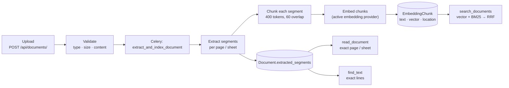
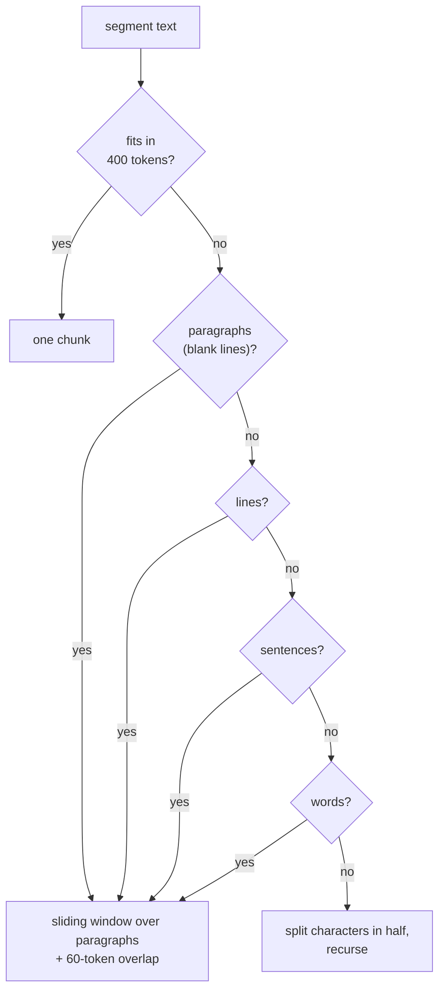
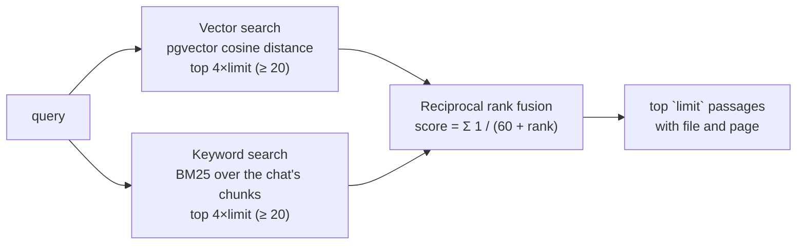

# Retrieval

How an uploaded file becomes something the agent can search, read exactly and cite by page.



Three complementary ways to reach the text: **search** to find where something is, **exact
reading** to copy it correctly, and **exact line matching** for terms that ranking can't
single out.

## 1. Extraction

`DocumentProcessingService.extract_segments` returns the text in labelled parts:

| File type | Segments | Library |
|---|---|---|
| PDF | one per page, labelled `p. 1`, `p. 2`, … | pypdfium2 |
| Excel (`.xlsx`) | one per sheet, labelled `sheet: <name>` (**every** sheet) | pandas + openpyxl |
| CSV | one unlabelled segment (the table as text) | pandas |
| Text, Markdown, JSON, code (`.py .js .ts .java .c .cpp`) | one unlabelled segment | — |

Decisions and the problems behind them:

- **Pages are kept apart from the start.** A citation that says "p. 6" is only possible if the
  page boundary survives extraction. Each segment is chunked separately, so no chunk spans two
  pages.
- **pypdfium2 instead of a pure-Python extractor.** The papers are two-column PDFs; the earlier
  extractor dropped the spaces between words ("intensivebutcanbeparalleled"), which made both
  search and reading unreliable. pdfium keeps spacing and reading order.
- **Hyphenation is repaired.** pdfium marks a word broken across lines with U+FFFE
  (`men￾tion`); `clean_pdf_text` joins those back into whole words, so "mentions" is
  searchable.
- **Every spreadsheet sheet is read.** The earlier version read only the first sheet; GPU prices
  and a notes sheet saying "exclude failed runs" lived on other sheets, and questions that
  depend on them were unanswerable.
- **Uploads are validated by content, not only extension**, and are size-limited
  (`DOCUMENT_MAX_UPLOAD_MB`, 20 MB by default).

## 2. Chunking

`ChunkingService` splits each segment into chunks of at most `RAG_CHUNK_TOKENS` (400) tokens
with `RAG_CHUNK_OVERLAP_TOKENS` (60) tokens of overlap, never more than the embedding model
accepts. It splits **recursively, at the largest natural boundary that works**:



**Why 400 tokens?** Chunks were first sized by the embedding model's input limit (8,192
tokens), which turned each 12-page paper into two chunks: every search returned half a paper,
and the vector of such a chunk means "this whole paper", not any passage in it. A few hundred
tokens is about one paragraph or a table: small enough that the vector represents one idea,
large enough to keep a table row with its header. The overlap keeps a sentence that straddles
a boundary findable from both sides.

## 3. Embeddings

Chunks are embedded with the **active embedding provider** (OpenAI `text-embedding-3-small` in
the benchmark; Gemini and local sentence-transformers models are also supported) and stored in
pgvector:

```
EmbeddedObject(content_type, object_id, provider, tag="chat:<id>")
└── EmbeddingChunk(text, embedding vector, chunk_index, location="p. 6", token_count)
```

Searches filter on the provider that produced the query vector, so a provider switch never
compares vectors from two different models (see
[architecture.md](architecture.md#providers)).

## 4. Hybrid search

`EmbeddingService.hybrid_search` merges two rankings of the chat's chunks:



### Vector search

One SQL query with pgvector's cosine distance operator, filtered by provider, content type
and tag, so it only ever sees the chat's own documents:

```sql
SELECT eo.content_type_id, eo.object_id,
       1 - (c.embedding <=> %s::vector) AS score, c.text, c.location
FROM ai_core_embeddingchunk c
JOIN ai_core_embeddedobject eo ON eo.id = c.embedded_object_id
WHERE eo.provider_id = %s AND eo.content_type_id = %s AND eo.tag = %s
ORDER BY score DESC
LIMIT %s;
```

Matched objects are then loaded with one query per content type (not one per row).

### Keyword search (BM25)

Vectors find passages that *mean* the same thing; they are weak at exact names, numbers and
rare terms. In the benchmark, a paragraph with every answer to a question
("inter-annotator agreement of NEL is 94.61%") shared its chunk with a figure caption about a
horror film; its vector drifted, and it ranked 8th of the results, outside what the agent saw.

BM25 scores each chunk for the query's words:

$$
\text{score}(D, Q) = \sum_{t \in Q} \text{IDF}(t) \cdot \frac{f(t, D)\,(k_1 + 1)}{f(t, D) + k_1\left(1 - b + b\,\frac{|D|}{\text{avgdl}}\right)},
\qquad \text{IDF}(t) = \ln\!\left(1 + \frac{N - n_t + 0.5}{n_t + 0.5}\right)
$$

with $k_1 = 1.5$ and $b = 0.75$. Rare words weigh more, so "inter-annotator" outweighs
"dataset".

- **Tokenisation is Unicode-aware** (`\w+`), so Persian words are kept. Arabic letter forms
  that Persian text also uses (`ي` / `ی`, `ك` / `ک`, `ى`, `ة`) are folded, so either spelling
  matches.
- **It runs in Python over the chat's chunks**, which is a few hundred to a few thousand rows.
  Above `KEYWORD_SCAN_LIMIT` (5,000 chunks) keyword search is skipped and vectors alone
  decide. **Why not PostgreSQL full-text search?** Its ranking (`ts_rank`) has no inverse
  document frequency, so common words dominate unless you maintain language-specific stop-word
  lists, which would break the "Persian works everywhere" rule. A real BM25 index is the
  natural next step at larger scale.

### Merging: reciprocal rank fusion

The two rankings have incomparable scores (cosine similarity vs BM25), so they are merged by
**rank**, not score:

$$
\text{RRF}(d) = \sum_{r \in \{\text{vector},\,\text{keyword}\}} \frac{1}{60 + \text{rank}_r(d)}
$$

A passage near the top of either list rises; a passage high in both rises most. With hybrid
search, the passage from the example above moved from 8th to 3rd.

**Long-term memory keeps plain vector search**, because it filters memories by a similarity
threshold (0.5), which RRF scores don't provide.

## 5. Exact reading

`read_document(name, part)` reads stored segments, not chunks:

- a page (`6`), a range (`5-7`) or a sheet name (`gpu_prices`);
- **whole pages only** up to the output limit, then a note: `[Shown: p. 1, p. 2. Not shown yet:
  p. 3-12; read them with part='3-12'.]` (an earlier version silently cut long ranges
  mid-page, so the agent never learned an appendix existed);
- without `part`, short documents come whole, long ones list their parts, and a long file
  without parts (a CSV) shows its first lines and points to `run_python`.

## 6. Exact matching

`find_text(text, name?)` returns **every line containing all the given words**, with the line
before and after (PDF lines are short; a value is often on the next line) and the page:

```
[2] (refined.pdf, p. 11) # candidates 30 / # entity types 1400 / mention transformer init. roberta-base
```

It exists for terms that appear everywhere. "Entity types" occurs on almost every page of one
paper, so neither vectors nor BM25 can single out the hyperparameter row that holds the
answer; an exact line search can. The agent must run it before claiming a document doesn't
report something.

## Web sources

With web search on, the agent's web tools follow the same principles:

- `web_search` uses `ddgs` (no API key), trying the configured backends one at a time
  (`WEB_SEARCH_BACKENDS`, default `duckduckgo,yahoo`) because a single blocked backend
  shouldn't fail the search.
- `fetch_page` fetches only public http(s) addresses (see [security.md](security.md#ssrf)),
  converts HTML to text keeping table rows, list items and headings, and returns the windows
  most relevant to the query.
- `wikipedia` uses the MediaWiki API: `action=parse` for real sections and tables (plaintext
  extracts drop tables), `prop=revisions` with `rvstart` for "as of" questions, and a
  revision-pinned URL (`oldid=`) in the citation, so the cited page is the one that was read.
