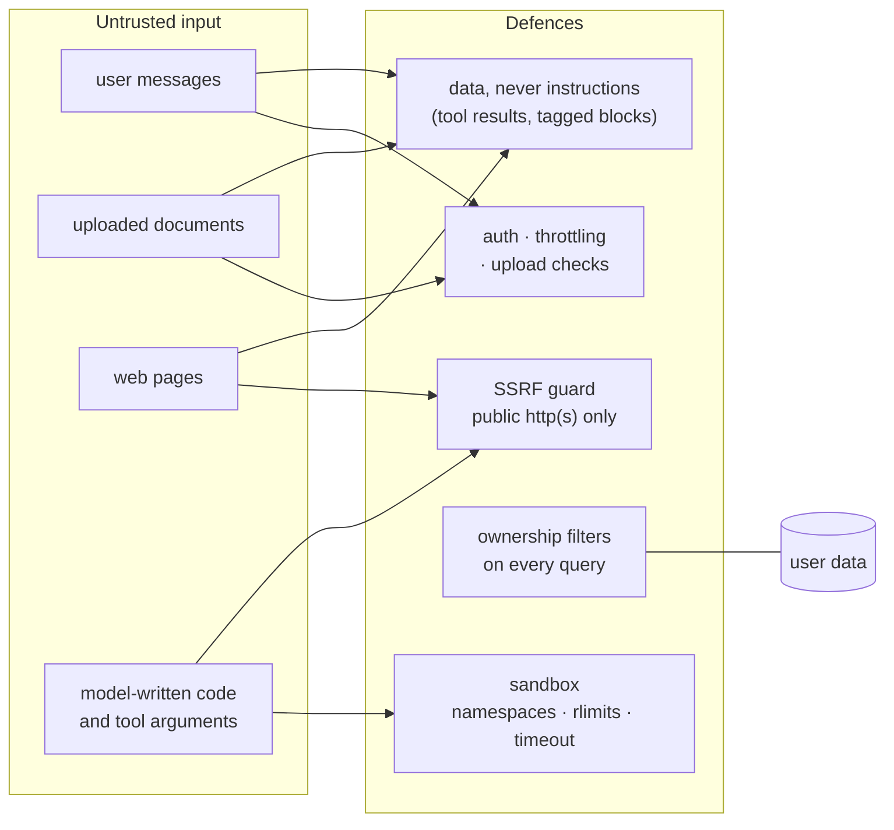

# Security

A research assistant reads untrusted documents, fetches arbitrary web pages and runs code a
model wrote. Each of those is an attack surface. This page lists the threats DeepQuery
considers and what stands in their way.

## Prompt injection

A document or web page may contain text like "ignore your instructions and…". DeepQuery treats
everything it didn't write itself as **data, never instructions**:

- Document text, web pages and tool output enter the conversation only as `tool` results (agent)
  or inside `<sources>` / `<memory>` blocks (single-pass), never in the system role.
- The system prompt says explicitly that text in those blocks is untrusted reference data to be
  used as evidence only.
- Free-text request fields are never pasted into the prompt. Answer options such as audience and
  depth are mapped from fixed values (`{"General": "a general audience", ...}`), so a request
  can't smuggle instructions in through them.
- Tools return text; they can't change the agent's instructions, its tool list or its stopping
  rules.

Prompt injection can't be fully prevented with today's models; these measures limit what an
injected instruction can reach. The tools themselves are read-only (search, read, fetch, run
code in a sandbox): there is no tool that writes user data or sends messages.

## SSRF

`fetch_page` and the single-pass web pipeline fetch URLs a model chose. Without checks, a prompt
could make the server fetch `http://169.254.169.254/` (cloud metadata) or internal services.
`check_public_url` allows a URL only if:

1. the scheme is `http` or `https`;
2. the host resolves, and **every** address it resolves to is globally routable
   (`ipaddress.is_global`; IPv4-mapped IPv6 addresses are unwrapped first), which excludes
   loopback, private ranges, link-local and metadata addresses.

Redirects are followed **manually, one at a time, re-checking each target**, so a public URL
can't redirect into the internal network. Responses are capped at 2 MB and every request has a
timeout.

## Code execution

Model-written code runs with time, memory, file-size and process limits, without network, on
read-only copies of the chat's own files; with bubblewrap it sees only the Python install and its
working directory. The fallback subprocess mode does not isolate the filesystem. Details and
limits: [code-execution.md](code-execution.md).

## Ownership

Every query that returns or changes user data filters by the requesting user:

- chats, messages and documents are fetched through querysets scoped to `request.user`;
- the agent's tools only see documents of the current chat **and** user
  (`Document.objects.filter(chat__id=..., user_id=...)`), and searches are scoped by the
  `chat:<id>` tag;
- uploaded images are never served from a public URL: `/api/messages/<uuid>/image/` checks that
  the message belongs to the requester.

Tests cover cross-user access for chats, messages, documents and images.

## Authentication

- JWT access tokens (60 minutes) and refresh tokens (1 day); the client refreshes once on 401.
- Throttled sign-in, sign-up, Google sign-in and refresh endpoints (`AUTH_THROTTLE_RATE`).
- Django's password validators on sign-up.
- Google ID tokens are verified server-side against `GOOGLE_CLIENT_ID`.
- Every API endpoint requires authentication unless it explicitly opts out.

## Secrets

- Provider API keys are **encrypted at rest** (Fernet, `ai_core/fields.py`) with
  `FIELD_ENCRYPTION_KEY`, or a key derived from `SECRET_KEY` if unset.
- Logging never includes prompts, document text, tokens or API keys (`logging` only; a test
  forbids `print`).
- `.env`, uploads, model files and local databases are git-ignored.
- In the sandbox, code runs with an empty or minimal environment, so server secrets in
  environment variables are not visible to it.

## Uploads

- Allowed types only (PDF, Excel, CSV, text, Markdown, JSON and common code files), checked by
  extension **and** content.
- Size limits: `DOCUMENT_MAX_UPLOAD_MB` (20) and `CHAT_IMAGE_MAX_UPLOAD_MB` (10).
- Daily per-plan limits on messages, documents and images.

## Checked by tests

`server/deepquery/tests/test_code_rules.py` enforces rules that are easy to break by accident:
no `print` calls, every outgoing HTTP client call has a timeout, and every pinned dependency
matches what is installed. Other tests cover the SSRF guard (private, loopback, mapped-IPv6
and redirect cases), the sandbox, ownership checks and auth throttling.

## Known limits

- The sandbox's subprocess fallback can read files the server user can read; use bubblewrap or
  a container.
- In Docker, code runs inside the API container (subprocess mode), which can read the uploads
  volume. Run code execution in a separate container for multi-tenant deployments.
- Prompt injection is mitigated, not solved.
- `DEBUG` must be `False` and `SECRET_KEY` set in production (the Docker setup defaults
  `DEBUG` to `False`).
